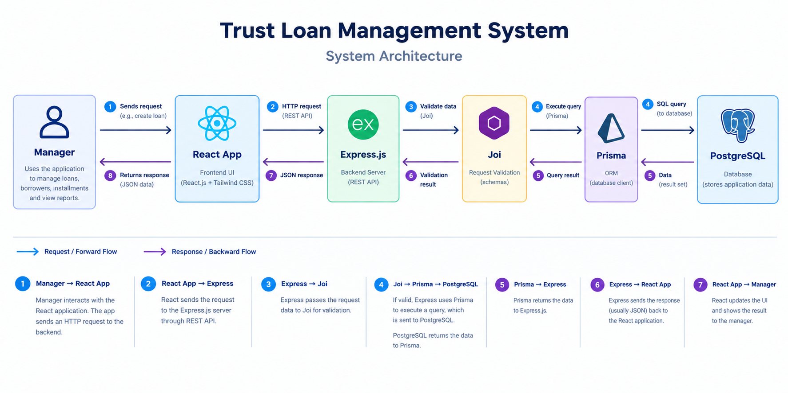
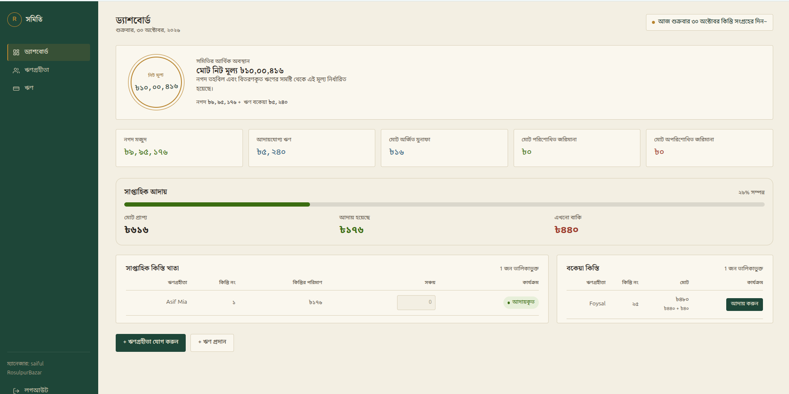
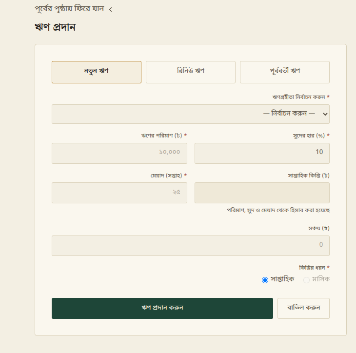
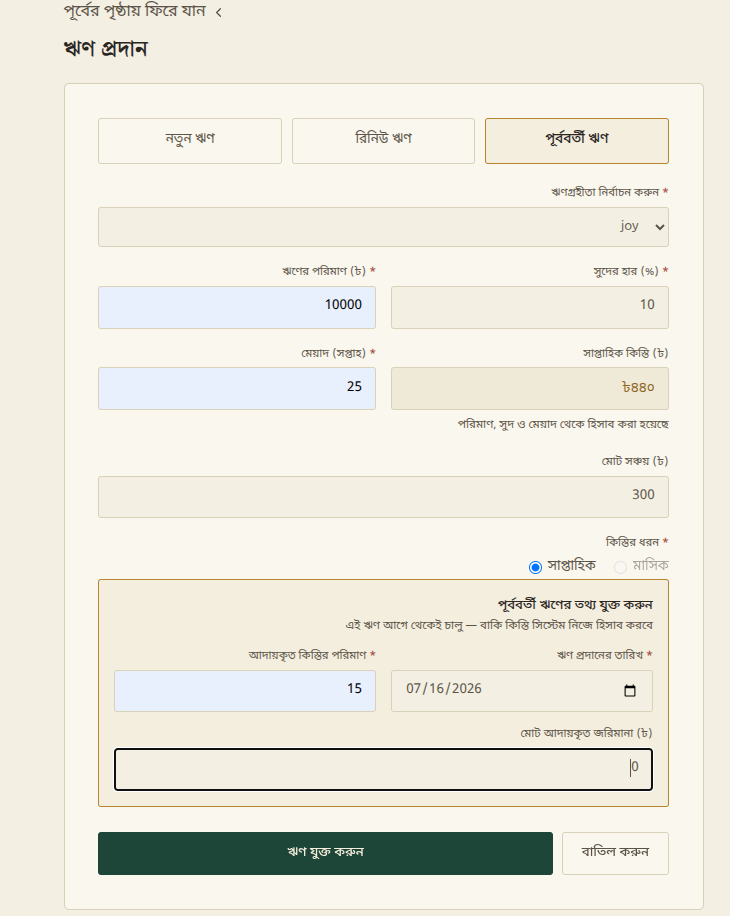

# Trust Loan Management System

**Live Demo:** [Visit Application](https://somiti.asifmia-tech.workers.dev)

## Table of Contents

1. [Overview](#overview)
2. [Features](#features)
3. [Technology Stack](#technology-stack)
4. [Project Architecture](#project-architecture)
5. [Project Structure](#project-structure)
6. [Prerequisites](#prerequisites)
7. [Installation and Setup](#installation-and-setup)
8. [Environment Variables](#environment-variables)
9. [Database Schema](#database-schema)
10. [API Documentation](#api-documentation)
11. [Screenshots](#screenshots)
12. [Future Improvements](#future-improvements)
13. [License](#license)


## Overview

Trust Loan Management System is a full-stack application designed to simplify loan and financial management for local trusts, commonly known as *Somitis*.

The application allows users to register and create a Somiti by providing the necessary information. Managers can register borrowers, issue new loans, record existing loans, and automatically schedule installment payments.

The system enables managers to collect installments, track payment statuses, and identify overdue installments, including applicable fines. Its dashboard provides an overview of the Somiti's financial position and a weekly collection summary, helping managers monitor financial activities and manage loan operations efficiently.

## Features

- **Loan Issuance:** Issue new loans to registered borrowers.
- **Installment Scheduling:** Automatically schedule installment payments according to loan terms.
- **Installment Collection:** Collect installment payments from borrowers.
- **Existing Loan Registration:** Register previously issued loans in the system, with installments backfilled and balances adjusted automatically so the historical state is reflected accurately.
- **Overdue Installment Tracking:** Identify unpaid installments and apply fines automatically through a scheduled daily job.
- **Loan Details and Repayment Tracking:** View total installments, collected installments, remaining dues, and outstanding loan balances.
- **Borrower Management:** Register borrowers and view borrower information.
- **Somiti Management:** Register and manage a Somiti.
- **Financial Dashboard:** Monitor the Somiti's net worth, cash balance, and loan activities.
- **Weekly Collection Summary:** Review a per-borrower breakdown of the current week's expected and collected installments.
- **User Authentication:** Email/password authentication and Google OAuth sign-in.


## Technology Stack

### Frontend
- **React.js** — Building the user interface.
- **Tailwind CSS** — Styling and responsive layouts.
- **React Context API** — Managing authentication and active-Somiti state across the app.

### Backend
- **REST API** — Enabling communication between the frontend and backend.
- **Express.js** — Handling HTTP requests and backend operations.
- **Joi** — Validating request data.
- **Prisma** — Managing database access through an ORM, using the `@prisma/adapter-pg` driver adapter.
- **JWT** — Authentication.
- **node-cron** — Scheduled job for marking overdue installments and applying fines.

### Database
- **PostgreSQL** — Storing and managing application data, hosted on [Neon](https://neon.tech) (serverless Postgres).

### Deployment
- **Backend:** Render
- **Database:** Neon
- **Frontend:** Cloudflare Workers

## Project Architecture

The Trust Loan Management System follows a client–server architecture, with a React-based frontend communicating with an Express.js backend through REST APIs. Prisma handles database operations between the backend and PostgreSQL.



## Project Structure

```
Somiti/
├── Server/                      # Express.js backend
│   ├── prisma/
│   │   ├── schema.prisma        # Database schema
│   │   └── migrations/          # Prisma migration history
│   ├── src/
│   │   ├── app/                 # App setup and route registration
│   │   ├── controllers/         # Request handlers
│   │   ├── services/            # Business logic (loans, installments, borrowers, finance)
│   │   ├── routes/              # Route definitions
│   │   ├── middleware/          # Authentication and other middleware
│   │   ├── jobs/                # Scheduled jobs (overdue marking)
│   │   ├── lib/                 # Prisma client instance and shared helpers
│   │   └── server.js            # Entry point
│   ├── .env                     # Environment variables (not committed)
│   └── package.json
├── Client/                      # React frontend
│   ├── src/
│   │   ├── components/          # Reusable UI components
│   │   ├── pages/                # Route-level pages (Dashboard, Loans, Borrowers, etc.)
│   │   ├── context/               # Auth and Somiti context providers
│   │   └── helper/                # Shared utilities (e.g. base URL)
│   └── package.json
├── setup.sh                     # One-command dependency setup for both apps
└── README.md
```

> Folder names above reflect the project's actual layout; verify against the repo if it has evolved since this was written.

## Prerequisites

Before running this project locally, make sure you have:

- **Node.js** — v20.19+, v22.12+, or v24.0+ (required by Prisma 7)
- **npm** — bundled with Node.js
- **A PostgreSQL database** — a free [Neon](https://neon.tech) project, or a local PostgreSQL install
- **Git**

## Installation and Setup

1. **Clone the repository**
   ```bash
   git clone https://github.com/AsifMia-dev/Somiti.git
   cd Somiti
   ```

2. **Set up the backend**
   ```bash
   cd Server
   npm install
   ```
   Create a `.env` file in `Server/` (see [Environment Variables](#environment-variables)), then:
   ```bash
   npx prisma generate
   npx prisma migrate deploy
   npm run dev
   ```

3. **Set up the frontend**
   ```bash
   cd ../Client
   npm install
   npm run dev
   ```

4. **Or use the setup script** to install dependencies for both apps in one step:
   ```bash
   chmod +x setup.sh
   ./setup.sh
   ```
   You'll still need to create `Server/.env` yourself, since it holds secrets that shouldn't be automated into a script.

## Environment Variables

Create a `.env` file inside `Server/` with the following keys:

| Variable | Description |
|---|---|
| `DATABASE_URL` | PostgreSQL connection string (Neon pooled connection recommended) |
| `JWT_SECRET` | Secret used to sign and verify JWT tokens |


> Confirm this list against `process.env` usage in the codebase (`grep -rn "process.env\." src/`), since it may not be exhaustive.

## Database Schema

The schema is defined in `Server/prisma/schema.prisma`. All primary keys are UUIDs. Core models:

| Model | Purpose |
|---|---|
| `Manager` | A user who owns and manages one Somiti |
| `Somiti` | The savings/credit group — collection day, frequency, and its borrowers |
| `Borrower` | A member of a Somiti, identified uniquely by NID per Somiti |
| `Loan` | A loan issued to a borrower — amount, interest rate, installment count |
| `LoanAccount` | A loan's running financial state — collected amount, due amount, fine, status |
| `Installment` | A single scheduled payment — due date, amount, status, fine |
| `SomitiFinance` | A Somiti's aggregate finances — cash balance, loan balance, net worth, interest and fine totals |

Key relationships: a Manager owns one Somiti; a Somiti has many Borrowers; a Borrower can have many Loans; each Loan has one LoanAccount and many Installments; each Somiti has one SomitiFinance record.

## API Documentation

> Representative endpoints based on the application's design — verify exact paths against `Server/src/routes/` before relying on this as a final reference.

| Method | Endpoint | Description |
|---|---|---|
| POST | `/auth/register` | Register a new manager |
| POST | `/auth/login` | Log in with email and password |
| POST | `/somiti` | Create a Somiti for the authenticated manager |
| GET | `/borrowers/:somitiId` | List all borrowers in a Somiti |
| GET | `/borrowers/:somitiId/eligible?loan_type=` | List borrowers eligible for a given loan type |
| POST | `/borrowers` | Register a new borrower |
| POST | `/loans` | Create a loan (new, renew, or existing) |
| GET | `/dashboard/:somitiId/balance-summary` | Get the Somiti's financial summary |
| GET | `/installment-sheet/:somitiId` | Get this week's and overdue installments with weekly summary |
| POST | `/installment-sheet/:somitiId/:installmentId/collect` | Collect a single installment |

## Screenshots





## Future Improvements

- **Loan renewal (রিনিউ):** The option exists in the UI but is currently disabled — the renewal flow (what, if anything, carries forward from the old loan) still needs to be designed.
- **Lump-sum early payoff (এককালীন পরিশোধ):** Let a borrower settle all remaining installments on a loan at once, from their profile.
- **Monthly collection frequency:** Currently only weekly collection is active; monthly is present in the schema but disabled in the UI pending further testing.
- **Installment history export:** CSV or PDF export of a borrower's or Somiti's installment history.

## License

This project is licensed under the [MIT License](LICENSE).